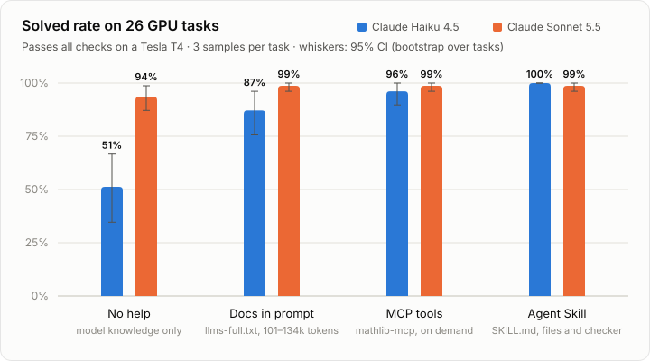

# mathlib-mcp

**Make GPU math libraries LLM-friendly, and measure whether it helps.**

LLMs write plausible but wrong code for GPU math libraries. They call functions that do not exist, use keyword arguments from an older SciPy, and miss behaviours that differ from NumPy, such as CuPy returning NaN for a singular matrix instead of raising. This project turns the APIs of **CuPy 14.2** and **nvmath-python 1.0** into an LLM-first representation, serves it to coding agents over **MCP**, and includes a **GPU benchmark** to measure the effect on generated code. Those two libraries are the Python front-ends to cuBLAS, cuFFT, cuSOLVER, cuSPARSE, cuDSS and cuTENSOR.

| Part | What it is |
|---|---|
| **API cards** | 2,741 public symbols and 275 API cards extracted from the library *sources* (no GPU or import needed). 43 cards are curated with the CUDA-X backend, pitfalls checked against the source and on a GPU, and an example verified on a GPU. |
| **MCP server** | `search_api`, `get_api_card`, `get_example`, `check_snippet`, plus an `llms.txt` resource. |
| **`check_snippet`** | Static checker that finds hallucinated APIs, wrong or positional-only keywords, too many positional arguments and missing arguments, and suggests the real name. |
| **Benchmark** | 26 GPU tasks across six CUDA-X libraries with NumPy/SciPy references; 17 have a "naive" solution that falls into a documented trap. |
| **Agent Skill** | The same cards, pitfalls, verified examples and checker as a [`SKILL.md` package](skills/cupy-nvmath-gpu-math) for Claude Code and other agents that load Agent Skills. No server process needed. |

## Results

<picture>
  <source media="(prefers-color-scheme: dark)" srcset="docs/results-dark.svg">
  
</picture>

The chart combines three runs: no help and docs from v1, the MCP tools from the v1.1 re-run, and the Agent Skill from v1.2 ([joint report](bench/results/eval-v1.2-all/report.md)). The sections below describe each run.

Two Claude models wrote solutions to the 26 benchmark tasks, 3 samples per task, under three conditions: no help; the full API reference (`llms-full.txt`) in the system prompt; or the mathlib-mcp tools. Every solution was run on a Tesla T4 and checked against NumPy/SciPy references ([full report](bench/results/eval-v1/report.md), [all attempts and transcripts](bench/results/eval-v1/)).

| | No help | Docs in prompt | MCP tools |
|---|---|---|---|
| **Claude Haiku 4.5**: tasks solved | 51% | 87% | **92%** |
| final code with a hallucinated API or wrong arguments¹ | 36% | 1% | 4% |
| input tokens per task | 0.4k | 101.6k | 15.3k |
| cost per task | $0.003 | $0.014 | $0.018 |
| **Claude Sonnet 5.5**: tasks solved | 94% | 99% | 99% |
| final code with a hallucinated API or wrong arguments¹ | 3% | 1% | 1% |
| input tokens per task | 0.5k | 134.4k | **3.5k** |
| cost per task | $0.006 | $0.035 | **$0.008** |

¹ Scored with the fixed `check_snippet` (see the bug note below). The run itself used the version before the fix, which accepted the three `cupy.cublas` attempts.

What the numbers say:

- **Haiku 4.5 goes from coin-flip to reliable.** Tasks solved rise by **+41 points** (95% CI +26 to +58), and hallucinated APIs fall from 36% of attempts to 4%. The remaining 4% are the three `cupy.cublas` attempts described below. The biggest gain is on nvmath-python (6% → 83% solved), a library newer than the model.
- **On-demand knowledge beats putting it all in the prompt.** Both conditions contain the same curated knowledge. MCP solved slightly more for Haiku (+5 points, CI +1 to +10). Sonnet matched the docs prompt with **38× fewer input tokens, at a quarter of the cost**.
- **Sonnet 5.5 already knows most of these APIs** (94% without help), so it calls the tools only when unsure (0.6 calls per task). Its one remaining MCP failure is a JAX keyword (`cupy.repeat(..., total_repeat_length=)`) in code it did not run through `check_snippet`.
- **The evaluation found a bug in the tool itself.** In all three failed Haiku + MCP attempts at `batched_solve_vectors`, Haiku called `cupy.cublas` after only `import cupy`. That submodule is not loaded by `import cupy`, but `check_snippet` accepted the code. The cause: the symbol index treated every submodule as an attribute of its package. **Fixed after v1.** The extractor now works out which modules `import X` actually loads, by following module-level imports through the source. Cards now say when an extra import is needed, and two new GPU-checked facts confirm the model (`import cupy` does not load `cupy.cublas`; `import cupyx.scipy.sparse` does not load `.linalg`). Re-checked against all 468 v1 attempts, the fixed checker raises **no false alarms on the 407 attempts that passed** on the GPU. It flags **36 of the 41 that failed with an API-type error**. The five it misses are beyond a static check: two implicit NumPy conversions, a key inside an options dict, a cuDSS memory-layout requirement, and a call into an internal Cython module. The solved rates above measure the tool before the fix; re-running the MCP condition would measure it, optimistically, since the task set is the same.
- **Knowledge alone is not enough when the semantics are counter-intuitive.** Haiku read the pitfall that cuBLASLt's bias epilog is per *row*, and still added the bias per column (0/3 in every condition). Sonnet got it right every time. Since v1, the matmul card spells out the transposed recipe for a per-column bias.

### Re-run after the fix (v1.1, MCP condition)

After fixing the checker, the MCP condition was re-run with both models: 156 attempts, $2.12 ([report](bench/results/eval-v1.1-mcp/report.md)).

| Tasks solved with the MCP tools | v1 | v1.1 |
|---|---|---|
| Claude Haiku 4.5 | 92% | **96%** |
| Claude Sonnet 5.5 | 99% | 99% |

- **Both targeted tasks were fixed.** Haiku went from 0/3 to 3/3 on `batched_solve_vectors` (it now imports `cupy.cublas`) and on `fused_linear_relu` (it now uses the transposed bias recipe).
- **The overall change is within noise.** Two other tasks dropped, so Haiku's change against v1 MCP is +4 points (CI −6 to +17). Against no help it is now +45 points (CI +27 to +63).
- **The re-run exposed a wrong claim in the curated knowledge.** The `errstate` card said failed factorizations raise under `linalg='raise'`. Haiku followed that advice with `cupyx.scipy.linalg.lu_factor`, which never raises: on a singular matrix it only issues a `RuntimeWarning`. Two of three `solve_or_raise` attempts failed that way. The cards now say so, and a new GPU-checked fact confirms the behaviour.
- **These numbers are optimistic.** The fixes came from failures on the same tasks. The docs condition was not re-run, although `llms-full.txt` received the same fixes.

### The Agent Skill as a fourth condition (v1.2)

The same knowledge packaged as an [Agent Skill](skills/cupy-nvmath-gpu-math): `SKILL.md` in the system prompt, the reference files behind `grep` and `read_file` tools, and the checker script behind a `check_gpu_code` tool, which is how a coding agent reaches a skill's files. Both models, 26 tasks × 3 samples, 156 attempts, $4.38 ([report](bench/results/eval-v1.2-skill/report.md), [joint report of all four conditions](bench/results/eval-v1.2-all/report.md)).

| | No help (v1) | Docs in prompt (v1) | MCP tools (v1.1) | Agent Skill (v1.2) |
|---|---|---|---|---|
| **Claude Haiku 4.5**: tasks solved | 51% | 87% | 96% | **100%** |
| final code with a hallucinated API or wrong arguments | 36% | 1% | 0% | 0% |
| input tokens per task | 0.4k | 101.6k | 16.2k | 78.6k |
| cost per task | $0.003 | $0.014 | $0.019 | $0.043 |
| **Claude Sonnet 5.5**: tasks solved | 94% | 99% | 99% | 99% |
| final code with a hallucinated API or wrong arguments | 3% | 1% | 1% | 1% |
| input tokens per task | 0.5k | 134.4k | 3.5k | 12.7k |
| cost per task | $0.006 | $0.035 | $0.009 | $0.014 |

- **Haiku solved every task, 78 of 78 attempts.** Paired by task, that is +49 points over no help (95% CI +32 to +65), +13 over the docs in the prompt (+4 to +24) and +4 over the MCP tools (+0 to +10). No final solution had an API error.
- **The skill made Haiku follow the procedure.** It searched the references on 100% of attempts, read files on 92% and ran the checker on 100%. The cost is tokens: it reads `pitfalls.md` whole and the cards with context, 78.6k input tokens per task against 16.2k with MCP, so an attempt costs 2.3× as much and takes 15.5 s instead of 11 s.
- **Sonnet verified three times more often than with MCP** (the checker on 38% of attempts, against 12% in v1), but its result did not change: 99%, with the same single failure as before, `cupy.repeat(..., total_repeat_length=)`, a JAX keyword, in an attempt where it called no tool at all. The gap in point 4 below is narrower, not closed.
- **Same caveats as v1.1.** Same tasks and curated pitfalls, same author, so the numbers are optimistic. The docs condition is still the v1 version. The skill was simulated through API tools; inside Claude Code the agent uses its own file tools, which may read more or less.

Caveats:

- **Same author.** The tasks and the curated pitfalls were written by the same person. The docs and MCP conditions therefore measure how well *known* pitfalls are delivered, not whether unknown ones are discovered. An independently written held-out task set is the next step.
- **Wide intervals.** With 26 tasks × 3 samples, the 95% intervals are ±10–15 points. Sonnet is near the ceiling, so its differences are within noise.
- **Pipeline controls.** Every reference solution passed (26/26), every naive trap solution failed (17/17), and every null solution failed (26/26). There were 0 infrastructure errors. Generation cost $6.58 in total.

## What we learned

1. **Curated, verified knowledge does most of the work; MCP and the Agent Skill are two ways to deliver it.** For Haiku, putting the whole reference in the prompt already gave most of the gain (51% → 87%). The MCP tools added a little more (92–96%), and the Skill a little more again (100%). The value is in the content: exact signatures, pitfalls and recipes checked on a GPU.
2. **The benefit depends on the model.** Haiku 4.5 gained +41 to +45 points, and its hallucinated APIs almost disappeared. Sonnet 5.5 was already at 94% and gained 5 points. The help matters most for smaller models and for APIs newer than the model: on nvmath-python, Haiku went from 6% to 83%.
3. **On-demand delivery scales; a stuffed context does not.** The same knowledge took 3.5k–15k input tokens through the tools, against 101k–134k in the prompt (38× fewer for Sonnet, at a quarter of the cost). Two libraries already take half of Haiku's 200k-token context window, so a whole CUDA-X stack would not fit. The cost is extra turns and latency (11.5 s versus 4.5 s per task for Haiku).
4. **Verification is the most distinctive piece, but the model has to use it.** `check_snippet` catches 36 of 41 runtime API failures with no false alarms. Haiku ran it on 99% of attempts; Sonnet on 12%. Sonnet's one remaining failure was in code it never checked. A Skill whose procedure ends with "run the checker" raised Sonnet's rate to 38% and Haiku's to 100%, but Sonnet still skipped it on the one task it got wrong.
5. **Knowing is not applying.** A warning ("the bias is per row") did not help Haiku. A concrete recipe did (0/3 → 3/3). Pitfalls work best when they show the correct code.
6. **The knowledge layer needs its own tests.** Both regressions came from the tool, not the model: the checker accepted a missing submodule import, and a card over-generalised `errstate`. The evaluation found both. Facts checked on a GPU, plus re-running the evaluation after each change, catch errors that reading the source does not.

## Future work

- **Held-out tasks.** Tasks written independently of the curated pitfalls, so the results measure generalisation rather than delivery of known pitfalls.
- **Harder tasks.** Sonnet 5.5 is near the ceiling on this set, so harder tasks are needed to measure stronger models.
- **A leaner Skill.** Haiku reads `pitfalls.md` whole on most attempts, which is where the 78.6k input tokens per task go. Splitting the pitfalls by area, or sending the model to the card before the pitfalls, might keep the 100% at MCP-level cost.
- **Evaluation inside real coding tools.** Run the same tasks through Claude Code (headless, with the Skill installed) and other MCP clients, not only through the API with simulated file tools.
- **Re-run the docs condition** so the v1.1 tool is compared like for like (`llms-full.txt` received the same fixes).
- **Checker coverage.** Check keys inside `options={...}` dicts against the options dataclass, the one statically detectable miss among the five.

## Example

```text
$ check_snippet
import cupy as cp
import cupyx.scipy.sparse.linalg as spla
from cupy.linalg import lu_factor
import nvmath
x, info = spla.cg(A, b, tol=1e-8)
w = spla.eigsh(A, 3, 'SA')
e = nvmath.linalg.advanced.MatmulEpilog.RELU_BIAS_GELU

FAIL: 4 problem(s) found
- line 3 [error: unknown-symbol] `cupy.linalg.lu_factor` does not exist (no `lu_factor` in module `cupy.linalg`). Did you mean: `cupyx.scipy.linalg.lu_factor`?
- line 5 [error: unknown-keyword] `cupyx.scipy.sparse.linalg.cg` has no parameter `tol`. Signature: `cg(A, b, x0=None, *, rtol=1e-05, atol=0.0, maxiter=None, M=None, callback=None)`. Did you mean: `rtol`, `atol`?
- line 6 [error: too-many-positional] `cupyx.scipy.sparse.linalg.eigsh` takes at most 2 positional argument(s) but 3 were given. Signature: `eigsh(a, k=6, *, which='LM', v0=None, ncv=None, maxiter=None, tol=0, return_eigenvectors=True)`.
- line 7 [error: unknown-attribute] `nvmath.linalg.advanced.MatmulEpilog` has no attribute `RELU_BIAS_GELU`. Did you mean: `nvmath.linalg.advanced.MatmulEpilog.RELU_BIAS`, `nvmath.linalg.advanced.MatmulEpilog.GELU_BIAS`, `nvmath.linalg.advanced.MatmulEpilog.RELU_AUX_BIAS`?
Checked 6 API reference(s): ...
```

A curated card, as an agent sees it (abridged):

```text
### `cupyx.scipy.sparse.linalg.cg`
cg(A, b, x0=None, *, rtol=1e-05, atol=0.0, maxiter=None, M=None, callback=None)
cupy 14.2.0 · function · backend: cuSPARSE (SpMV), cuBLAS · SciPy equivalent: scipy.sparse.linalg.cg

Pitfalls
- The tolerance keyword is `rtol` (keyword-only, matching SciPy >= 1.12). The old `tol=` raises `TypeError`.
- Returns `(x, info)`. `info == 0` means converged and `info > 0` is the iteration count reached without converging. Always check `info`.
...
```

## Use it with an agent

```bash
# Claude Code
claude mcp add mathlib -- uvx --from git+https://github.com/jarski/mathlib-mcp mathlib-mcp
```

Any MCP client works the same way: the server speaks stdio and has no runtime dependencies besides `mcp`. Semantic search is optional: `pip install mathlib-mcp[embeddings]` fuses a small embedding model into the BM25 ranking.

### Or as an Agent Skill

[`skills/cupy-nvmath-gpu-math`](skills/cupy-nvmath-gpu-math) packages the same knowledge as an [Agent Skill](https://agentskills.io): a `SKILL.md` procedure (find the function, read its card, write the code, run the checker), the API cards, pitfalls and verified examples as reference files, and a checker script. Nothing runs in the background; the agent reads the files it needs. It is also listed, free, on [Agensi](https://www.agensi.io/skills/gpu-math-in-python-cupy-and-nvmath-python-cuda-x), which installs it into Claude Code, Cursor, Codex CLI and other agents.

```bash
# Claude Code: a personal skill (or copy the folder into a project's .claude/skills/)
git clone https://github.com/jarski/mathlib-mcp
cp -r mathlib-mcp/skills/cupy-nvmath-gpu-math ~/.claude/skills/

# the checker behind the skill's script, also usable on its own
uv tool install git+https://github.com/jarski/mathlib-mcp    # provides mathlib-mcp-check
mathlib-mcp-check my_gpu_code.py
```

`uv run python scripts/build_skill.py` regenerates the reference files from `cards.json` and writes `dist/cupy-nvmath-gpu-math.zip` for skill marketplaces. The build fails if the skill's frontmatter names other library versions than the data was built from. Measured as the fourth condition of the benchmark, the skill took Claude Haiku 4.5 to 100% of the tasks solved (see [Results](#the-agent-skill-as-a-fourth-condition-v12)).

## How it works

```
library sources ──► static extractor ──► symbols.json  (existence + signatures, for check_snippet)
 (sdist / wheel,     ast + .pyi + .pyx     cards.json    (API cards)
  never imported)         │                llms.txt / llms-full.txt
                          ▼
              curation/cards/*.toml  (backend, pitfalls, examples; build fails if
                                      a curated API disappears from the source)
                          │
                          ▼
                 MCP server ◄──── coding agent
```

* **Static extraction.** CuPy and nvmath-python cannot be imported without CUDA, so the extractor reads their source with `ast`. It follows re-exports, `__all__` star imports, aliases (`MatmulEpilog = cublasLt.Epilogue`), lazy module `__getattr__`, `.pyi` stubs, Cython `.pyx` files, docstring templates (`{a}` placeholders filled by nvmath's `docstring_decorator`) and `functools.partial` wrappers. The output is reproducible from pinned versions: `scripts/fetch_sources.py`, then `mathlib-mcp-build`.
* **Curation is checked.** Every pitfall was checked against the 14.2.0 / 1.0.0 sources (for example, `cupy.linalg.solve` rejects a stacked `(B, M)` right-hand side, and cuBLASLt's bias epilog is per *row*). Behavioural claims are also executable [facts](bench/facts.py) that run on a GPU. A card's example is labelled "verified on <GPU, CUDA, versions>" only after it passes on a GPU in its current form.
* **Honest uncertainty.** Namespaces the index cannot list completely (Cython modules, excluded packages) give *unverified* notes instead of false errors. A test makes sure no curated example is ever flagged.

## Benchmark

| Family | Tasks | Examples of traps |
|---|---|---|
| cuBLAS / cuBLASLt | 6 | in-place `gemm(out=, beta=)`; per-row bias epilog; 24 GB broadcasting |
| cuFFT | 6 | `irfft` length for odd sizes; `nvmath.fft.fft` rejects real input and transforms all axes; nvmath inverse FFTs are unnormalized |
| cuSOLVER | 8 | batched `solve` needs `(B, M, 1)`; silent NaN unless `cupyx.errstate(linalg='raise')`; `svd` full matrices on a 60000×50 input |
| cuSPARSE | 4 | `cg(rtol=)` not `tol=`; `eigsh` has no `'SM'` and keyword-only `which` |
| cuDSS | 1 | column-major right-hand sides |
| cuTENSOR | 1 | `nvmath.tensor` contraction API |

Each task has a prompt, a NumPy/SciPy reference, a correctness check and a canonical GPU solution. Candidates run in a separate subprocess and are classified as `pass`, `wrong_answer`, `exception`, `not_on_gpu`, `expected_error_not_raised`, `timeout` or `crash`. Static scoring adds the API-error count from `check_snippet` and checks for the required API.

### Running the evaluation

```bash
uv run python -m bench.harness.generate --out bench/results/<run> --reps 3   # Claude API
uv run python bench/kaggle/make_kernel.py eval --user <kaggle-user> \
    --candidates bench/results/<run>/generations.jsonl
uvx --from kaggle kaggle kernels push -p bench/kaggle/build/eval             # Kaggle T4
uvx --from kaggle kaggle kernels output <kaggle-user>/mathlib-mcp-eval -p out
cp out/execution*.json* bench/results/<run>/
uv run python -m bench.harness.report bench/results/<run> --compare bench/results/eval-v1
uv run python -m bench.harness.merge --out bench/results/<joint> \
    bench/results/eval-v1:none,docs bench/results/eval-v1.1-mcp:mcp bench/results/<run>:skill
uv run python -m bench.harness.chart bench/results/<joint> --out docs
```

The harness gets the tool definitions and handlers from the real MCP server, calls them in-process, and checks on every call that the responding model is the one requested. It keeps infrastructure errors out of the scores, and stores the full transcript of every attempt.

### GPU validation

Before any model is scored, everything is checked on a real GPU: the canonical solutions must pass, the naive trap solutions must fail, every curated example must run, and every behavioural pitfall must hold. Latest run ([report](bench/results/gpu_validation.json)):

| Tesla T4 (sm_75, 15 GB) · CUDA 12.9 · CuPy 14.2.0 · nvmath-python 1.0.0 | Result |
|---|---|
| Canonical task solutions pass | 26 / 26 |
| Naive trap solutions fail as designed | 17 / 17 |
| Curated card examples pass | 39 / 39 |
| Pitfall facts hold | 26 / 26 |

The traps fail for the intended reasons. Examples: `OutOfMemoryError: ... 28,800,000,000 bytes` (svd with full matrices), `ValueError: The M dimension of the bias vector (48) must match the M dimension of A` (per-row bias epilog), and `TypeError: ... must be a matrix or vector with col-major layout` (cuDSS). The first run also found something the docstrings do not say: **nvmath-python's inverse FFTs are unnormalized** (`ifft(fft(x)) == n * x`, unlike NumPy and CuPy). That finding is now a checked fact, a pitfall on four cards, and a benchmark task.

```bash
uv run python bench/kaggle/make_kernel.py validate --user <kaggle-user>   # self-contained script
uvx --from kaggle kaggle kernels push -p bench/kaggle/build/validate      # runs on a Kaggle T4
uvx --from kaggle kaggle kernels output <kaggle-user>/mathlib-mcp-gpu-validation -p out
uv run python -m bench.summarize_validation out/gpu_validation.json
uv run python -m bench.record_verification out/gpu_validation.json && uv run mathlib-mcp-build
```

## Development

```bash
uv sync
uv run python scripts/fetch_sources.py   # pinned CuPy / nvmath-python sources -> .sources/
uv run mathlib-mcp-build                 # regenerate src/mathlib_mcp/data/
uv run python scripts/build_skill.py     # regenerate skills/*/references and dist/*.zip
uv run pytest                            # includes "packaged data is up to date"
uv run ruff check .
```

MIT licensed.
